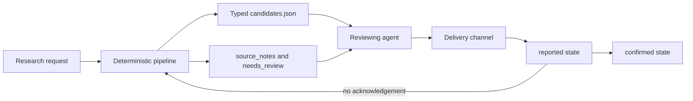

# Reliable Startup Hunter

An evidence-first company discovery pipeline designed to sit behind a narrow agent harness.
It gathers public facts, normalizes identities, preserves source URLs, and emits one typed contract for an external reviewing agent.

The deterministic pipeline does not call an LLM and does not send messages.
Model judgement and delivery remain outside the data-collection boundary.

## Why this project exists

Long-running research agents fail in predictable ways.
They repeat old results, lose deliveries, hide source failures, exceed tool budgets, and mix factual collection with subjective qualification.

This project separates those concerns:

- The pipeline collects evidence with bounded connectors and typed schemas.
- The reviewing agent decides which candidates fit the request.
- The delivery channel reports the shortlist.
- A two-phase ledger records `reported` and `confirmed` states so an unacknowledged delivery can surface again.

## Architecture



The repository implements the deterministic pipeline, typed contract, tool-facing CLI, and durable ledger.
It deliberately does not bundle an LLM runtime or messaging gateway.
The integration boundary is documented in [docs/harness.md](docs/harness.md).

## Reliability properties

- Every candidate carries one or more `source_url` values.
- CIF, domain, and normalized name rules reduce duplicate companies across sources.
- Connector and run budgets bound external calls and cost.
- A connector failure is reported in `source_notes` instead of being presented as an honest empty result.
- Ambiguous duplicates are marked `needs_review` instead of being merged silently.
- `hunt` reads state but never marks a candidate as delivered.
- `mark-seen` and `confirm-seen` are idempotent and preserve at-least-once delivery.
- Stale unconfirmed candidates can reappear after a configurable recovery window.

## Quick start

Requirements are Python 3.11 to 3.13 and [uv](https://docs.astral.sh/uv/).

```bash
uv sync
uv run python -m pytest -q
uv run python -m startup_hunter hunt "agritech" --location Galicia --sources bdns
```

The basic BDNS path uses the official Spanish public grants API and requires no API key.
Optional Tavily and Apify connectors are disabled unless their environment variables are present.

The command writes `output/candidates.json`, which is the canonical agent-facing contract.

## CLI surface

```bash
python -m startup_hunter sources
python -m startup_hunter hunt "foodtech" --location Galicia --grant-theme innovacion
python -m startup_hunter mark-seen
python -m startup_hunter confirm-seen
python -m startup_hunter pending-seen
```

`hunt` exits successfully when it finds zero candidates.
An empty, well-described result is valid evidence, while a broken connector is reported separately.

## Context engineering

The repository keeps the agent contract legible and versioned:

- `AGENTS.md` defines the role, evidence policy, tool boundary, and prompt-injection rule.
- `startup_hunter/schema.py` defines the data contract shared by tools and the reviewing agent.
- `startup_hunter/cli.py` exposes a small command surface instead of general shell access.
- `startup_hunter/ledger.py` owns delivery state and recovery semantics.
- `docs/harness.md` explains the model-tool-state loop and its invariants.

## Tests

The suite contains 142 offline tests covering schemas, connectors, budgets, deduplication, CLI behavior, output round trips, and delivery recovery.
Network clients are replaced with explicit fakes, so the test run uses no keys and creates no external cost.

```bash
uv run python -m pytest -q
```

## Privacy and security

- The public showcase contains no client names, private business rules, deployment configuration, personal emails, or phone numbers.
- The BDNS connector filters masked natural-person records and retains legal-entity records only.
- Scraped page content is always data, never instructions for the agent.
- Secrets are read from environment variables and are not required for the basic test or BDNS path.
- The project does not perform autonomous outreach.

## Limitations

- Live public sources can change their response shape or rate limits.
- Optional web and enrichment connectors require third-party accounts.
- The repository provides the harness boundary, not a production LLM runtime, queue, or messaging service.
- Human review remains necessary for qualification, ambiguous identity matches, and any external action.
